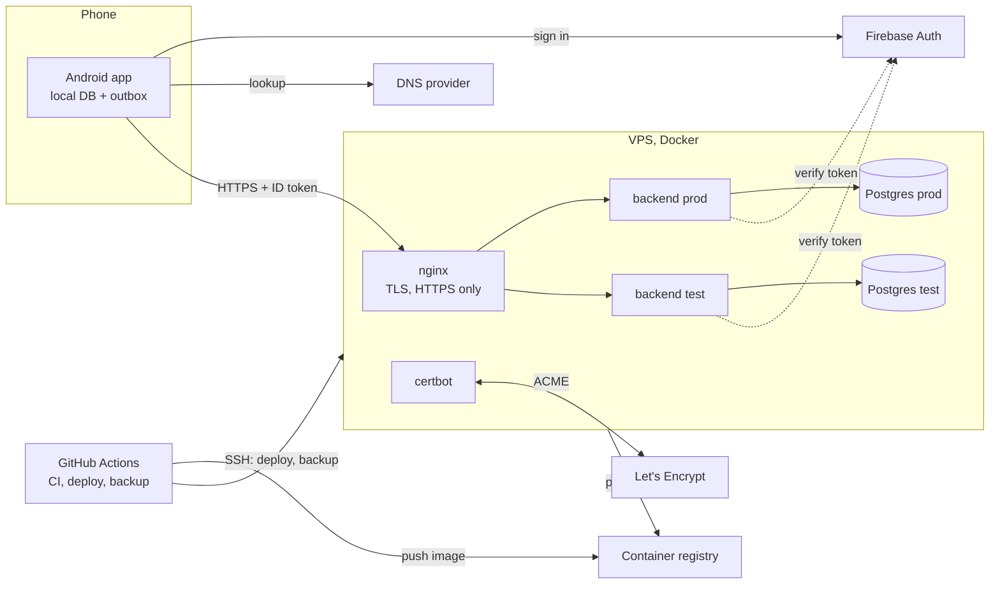
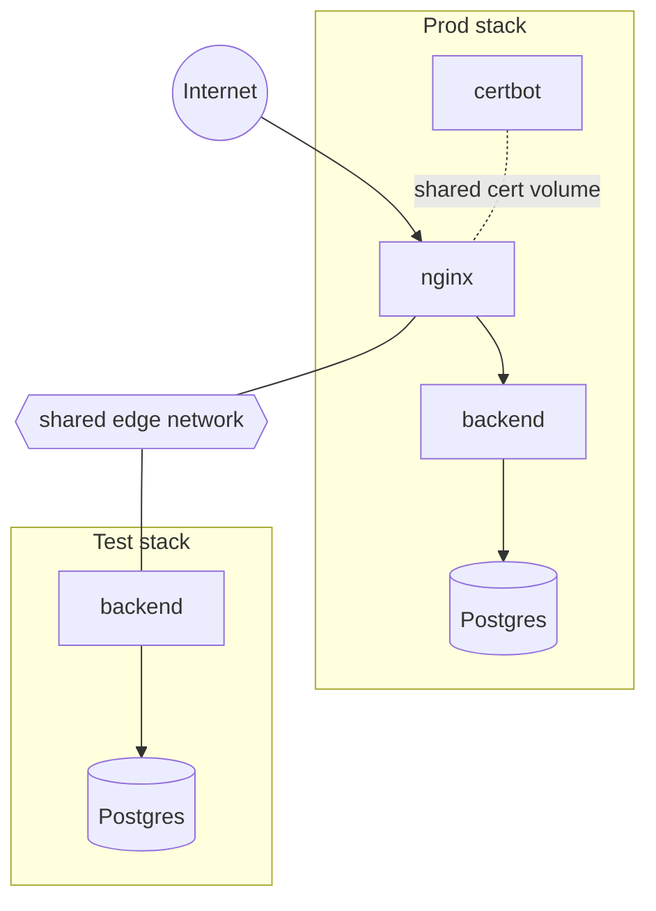
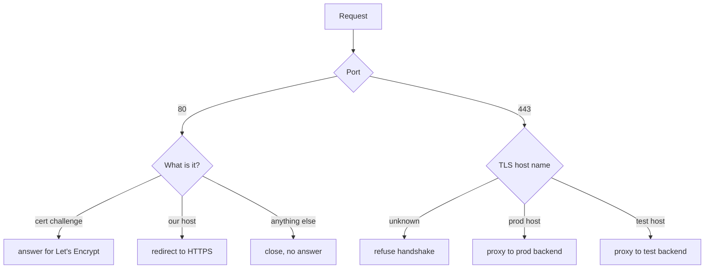
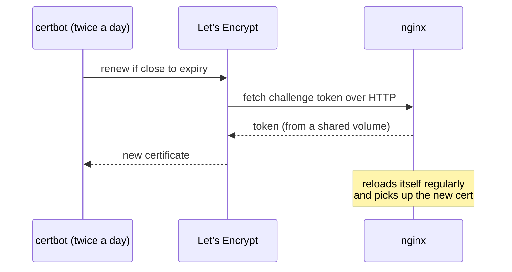
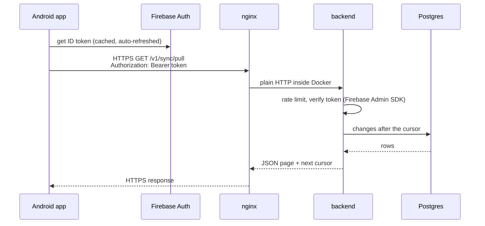
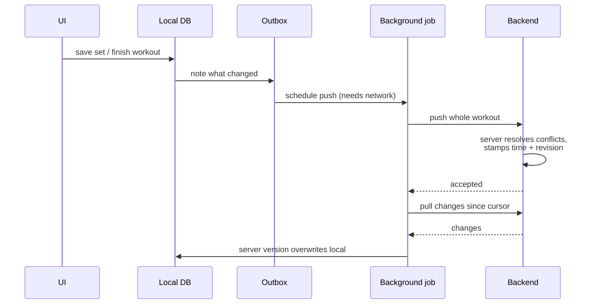
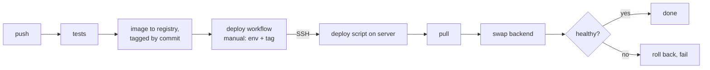
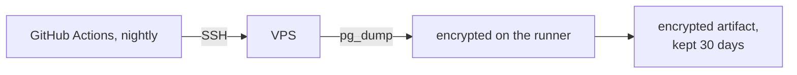

# Infrastructure

How GymBuddy runs: environments, the server, nginx, how a request and
a workout travel, CI/CD and backups. The reasons behind it are in
ADR 0016.

This page describes the design only. Host details, accounts and
secrets are kept outside the repo.

## 1. The big picture

- **One server, two environments.** Prod and test run side by side,
  each with its own backend, database, credentials and Firebase
  project. They share only nginx and the machine.
- **The app talks only to nginx.** Databases and backends have no
  public port.
- **One image everywhere.** CI builds the backend image once. It is
  configured only through environment variables and doesn't know
  where it runs.

## 2. Environments

| | Prod | Test | Local |
|---|---|---|---|
| API | `https://api.rukavina.app` | `https://api-test.rukavina.app` | `http://localhost:8080` |
| Backend | own container | own container, smaller heap | Docker Compose |
| Database | own Postgres | own Postgres | Postgres in Compose |
| Firebase | prod project | test project | either |
| Android flavor | `prod` | `qa` ("GymBuddy Test") | URL override |
| Backups | nightly, encrypted | none (disposable) | none |

The `qa` and `prod` apps install side by side on one phone. A `qa`
build can't touch prod data: it uses another URL and another Firebase
project, so prod rejects its tokens.

## 3. The server

One small VPS (2 vCPU, 2 GB RAM plus swap). It is set up from a
script, never by hand:

- SSH by key only, no password login.
- Firewall: only SSH, HTTP and HTTPS are open.
- Automatic security updates and log rotation.
- A non-root, no-sudo user runs the containers. CI has its own key.

Docker writes firewall rules that bypass the host firewall, so the
rule is: **only nginx publishes ports.** Everything else stays on
internal Docker networks.

### Containers and networks

- Each stack has its own private network. Each database is reachable
  only from its own backend.
- A shared edge network connects nginx with the test backend only, so
  test can never reach prod's database.
- nginx reaches each backend by a unique name per environment.
  Two services with the same name on one network would make requests
  land in the wrong environment. A local smoke test caught exactly
  that.

The whole box idles at about half its memory.

## 4. How nginx works here

nginx is the front door. It ends TLS, picks prod or test by host
name, and forwards plain HTTP to a backend inside Docker. Its config is
a template: the host names are filled in at start from the
environment.

- **Unknown hosts get nothing.** Scanners that hit the bare IP see no
  page and no certificate.
- **Our hosts:** HTTP/2, HSTS and a small request size limit. nginx
  passes the client IP and protocol to the backend in the usual
  `X-Forwarded-*` headers.
- **Deploys need no reload.** nginx looks each backend up through
  Docker's DNS per request, with a short cache. When a deploy replaces
  a backend container, nginx finds the new one by itself. If test is
  down, test answers 502 and prod is unaffected.
- **One certificate for both names.** The test host can't point at a
  missing certificate and stop nginx (and with it prod) from starting.

### Certificates

The first certificate comes from a one-time script. After that,
renewal is automatic, and no container needs access to Docker itself.

## 5. How a request travels

Example: the app pulls changes.

The backend is Spring Boot. Its parts:

| Part | Job |
|---|---|
| auth | Token check, per-user rate limit, creates the user on first call |
| api | Controllers, error format, request IDs in logs |
| sync | Push/pull, change log and cursor, account deletion |
| persistence | Database access |
| domain | Rules and validation |

The database schema is versioned. Migrations run when the backend
starts.

## 6. API

The contract is `api/openapi.yaml`. It is written by hand, the Android
client is generated from it, and a backend test fails if the code
drifts from it. Published docs: https://rukavina-git.github.io/GymBuddy/

| Endpoint | What |
|---|---|
| `GET /v1/health` | Liveness, no auth |
| `GET /v1/me` | Current user's profile |
| `DELETE /v1/account` | Delete the account and all its data |
| `POST /v1/sync/push` | Upload local changes |
| `GET /v1/sync/pull` | Download changes since a cursor |
| `GET /v1/reference/*` | Built-in exercises, templates, catalogue version |

Wire rules:
- timestamps are epoch milliseconds
- units are metric
- ids are UUIDv7, made by the client
- the server sets the change times and revisions
- deletes are tombstones
- the cursor is opaque

## 7. How a workout travels (sync)

The app is offline-first: it saves everything on the phone first and
syncs when there is a network.

The sync rules come from ADRs 0006–0010:
- Push first, then pull, never both at once.
- The server owns conflict resolution and every timestamp.
- A workout or template syncs as one whole tree.
- Guests keep their data on the phone until they sign up.

## 8. CI/CD

- Deploys are manual for now and default to test. Auto-deploy is
  planned.
- A failed health check puts the previous image back by itself.
- Other checks: Android build and unit tests, end-to-end sync tests,
  CodeQL, Sonar, OWASP dependency check, API lint and docs.

## 9. Backups

- Prod only; test data is disposable.
- The dump is encrypted before it is stored anywhere. Only the
  encrypted file is kept.

## 10. Monitoring

- An external uptime check on the health endpoint.
- Structured JSON logs from the backend, rotated on the box.
- Crash reporting on Android.

## 11. History

| When | What |
|---|---|
| Plan 1 | First host: a free PaaS plus a free managed Postgres |
| 2026-11-11 | ADR 0016: move to one self-hosted VPS, split test and prod |
| 2026-11-12 | Prod moved to the VPS, old hosting shut down |
| 2026-11-12 | Test environment live, Android `qa` flavor |

## 12. Third-party pieces

All are commercial-friendly: nginx (BSD-2), certbot (Apache 2.0),
PostgreSQL (PostgreSQL licence), Docker Engine and Compose
(Apache 2.0). The full table is in ADR 0016.
