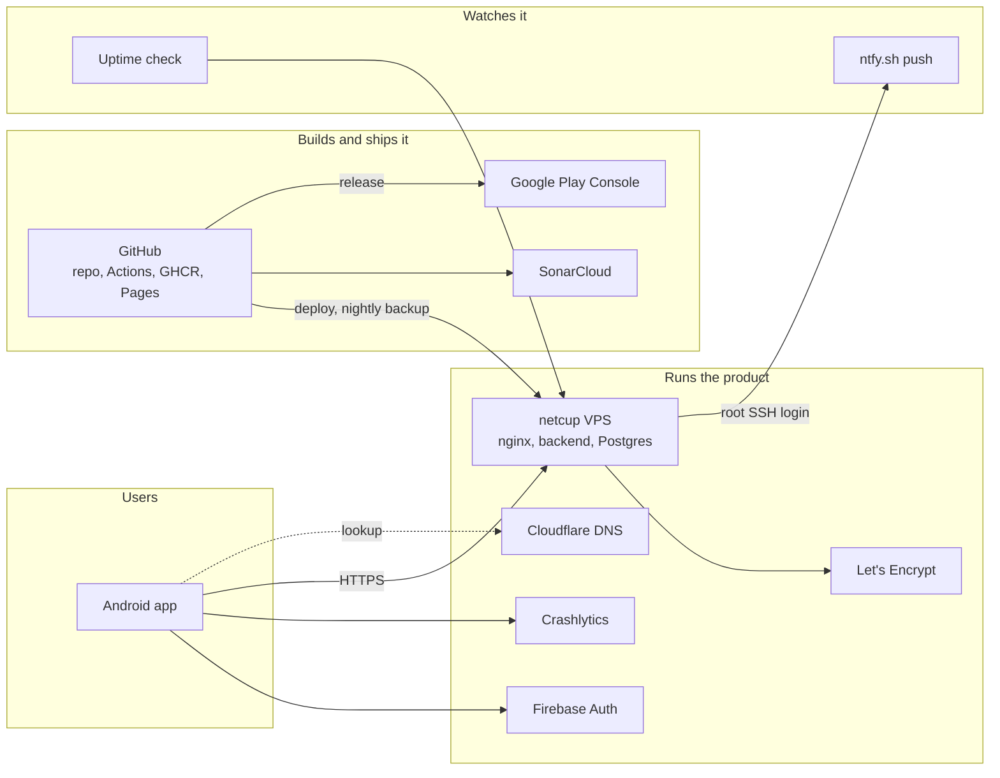

# Third-party services and tools

Every outside service, tool and asset GymBuddy (public name Gym
Tracker) relies on: what it is for, what data it sees, what it costs
and its licence or terms. How the pieces fit together is in
[infrastructure.md](infrastructure.md).

No accounts, hosts or secrets here. Those live in the owner's private
cheatsheet and Bitwarden.

Owner rule: nothing may block selling the app later. Code, fonts,
icons and data only under MIT, Apache 2.0, BSD, ISC, OFL, CC0 or CC BY.
GPL tools are fine only where they run on our server or laptop and
never ship in the app.

## 1. Big picture

## 2. Runtime: what the live app depends on

| Service | Use case | Data it sees | Cost | Terms / DPA |
|---|---|---|---|---|
| **netcup** (VPS, Germany) | One server runs prod and test: nginx, backend, Postgres, legal pages | Everything synced by account holders, server logs (IPs) | VPS nano, about €4/month | AVV (DPA) signed, health data declared |
| **Firebase Authentication** (Google) | Sign-in with email/password or Google; backend checks ID tokens | Email, uid, Google name and picture link, sign-in IPs | Free tier | Firebase Data Processing Terms; EU-US DPF + SCCs |
| **Firebase Crashlytics** (Google) | Crash and error reports to fix bugs | Error, app version, phone model, Android version, installation id, uid if signed in. Never workout or body data (key allow-list in `CrashReporter.kt`) | Free | Same as above; kept 90 days |
| **Cloudflare** | DNS for rukavina.app. API records are DNS-only (grey cloud), so traffic and TLS go straight to our nginx | DNS lookups only | Free | Not a processor for app data |
| **Let's Encrypt** | TLS certificates, renewed by certbot | Host names | Free | No use restrictions |
| **Vercel** | Hosts the rukavina.app home page (not the app's API or legal pages) | Visitors of that page | Free | Separate from the app |

Environments: prod and test each have their own Firebase project,
database and backend on the same VPS. Details in
[ADR 0016](adr/0016-vps-hosting-and-environments.md).

## 3. Build, release and quality

| Service | Use case | Cost | Notes |
|---|---|---|---|
| **GitHub** (repo) | Source, PRs, issues. Public repo (portfolio) | Free | develop → main by PR only |
| **GitHub Actions** | CI (build, tests, lint), deploys over SSH, nightly DB backup | Free (public repo) | Workflows in `.github/workflows/` |
| **GitHub Container Registry** | Backend Docker images, tagged by commit | Free | VPS pulls from it |
| **GitHub Actions artifacts** | Nightly prod DB dump, AES-256 encrypted before upload, kept 30 days | Free | GitHub can't read the dumps; key is not on GitHub |
| **GitHub Pages** | Published API docs (Swagger UI) | Free | https://rukavina-git.github.io/GymBuddy/ |
| **Dependabot** | Alerts and PRs for vulnerable dependencies | Free | Must be 0 open before a release |
| **CodeQL** | Static security analysis (Kotlin, JS, Actions) | Free | ADR 0013 |
| **SonarCloud** | Code quality gate on develop | Free (public repo) | Must be green before a release |
| **OWASP Dependency-Check** (+ NVD API key) | Known-CVE scan of dependencies | Free | Apache 2.0 |
| **Google Play Console** | Publishing the Android app, closed testing | One-time $25 developer fee | Data safety answers in `plans/legal-privacy/data-safety.md` |

Release tooling: fastlane (MIT) uploads builds to Play
([ADR 0017](adr/0017-fastlane-and-release-branches.md)).

## 4. Operations and security

| Tool | Use case | Licence / cost | Where |
|---|---|---|---|
| **ntfy.sh** + ntfy iPhone app | Push to the owner's phone on every root SSH login to the VPS (deploy-user logins don't alert), and "New feedback" from the backend (one topic per stack, no message text) | Free; app and server Apache 2.0 / GPL-2.0 dual, not shipped | `docker/server/setup.sh`, `FeedbackNotifier`; secret topics in Bitwarden |
| **fail2ban** | Bans an IP for 1 h after 5 failed SSH logins in 10 min | GPL-2.0, server only | `setup.sh` |
| **ufw** | Firewall: only 22, 80, 443 open | GPL-3.0, server only | `setup.sh` |
| **unattended-upgrades** | Automatic security updates, no auto-reboot | GPL-2.0, server only | `setup.sh` |
| **Uptime check** | Pings `/v1/health`, alerts on outage | Free plan | Owner's account |
| **Bitwarden** | All secrets and keys (deploy key, DB passwords, backup key, ntfy topic) | Free/personal | Never in the repo |

ntfy.sh messages are not end-to-end encrypted. Login pushes say who
logged in, from which IP and when; feedback pushes say only "New
feedback". No user data.

## 5. Server software

All run on the VPS in Docker or on the host, never in the app.

| Component | Use case | Licence |
|---|---|---|
| Debian 13 | Server OS | Free, OSS components |
| Docker Engine + Compose | Runs every service in containers | Apache 2.0 |
| nginx | TLS, HTTPS only, routes prod/test by host name | BSD-2-Clause |
| certbot | Renews certificates | Apache 2.0 |
| PostgreSQL 17 | Database, one per environment | PostgreSQL Licence |
| Spring Boot, Flyway, Firebase Admin SDK | Backend framework, migrations, token checks | Apache 2.0 |
| Firebase JS SDK 13.3.0 (loaded from www.gstatic.com) | Google sign-in on the owner's feedback admin page (`/admin/`, browser only, not in the app) | Apache 2.0 |

## 6. Inside the app

Libraries are collected by the AboutLibraries plugin on every build.
Any licence outside the allow-list fails the build
([ADR 0018](adr/0018-licence-gate.md)). Users see the full list in
You → About → Open-source licences.

Main pieces: Kotlin, Jetpack Compose, Hilt, Room, WorkManager,
Retrofit + Moshi (generated from `api/openapi.yaml`), Firebase Auth
and Crashlytics SDKs, Play In-App Updates (`com.google.android.play:app-update`,
Play Core SDK Terms; forced or offered updates from 0.2.2), Play In-App Review
(`com.google.android.play:review`, Play Core SDK Terms; rating prompt from 0.2.3). All Apache 2.0, MIT or Google SDK terms (allowed
for Google's own SDKs only).

| Asset | Source | Licence |
|---|---|---|
| UI icons | Material Symbols Rounded | Apache 2.0 |
| Font | Figtree | OFL 1.1 |
| Profile avatars (20 animals) | Microsoft Fluent Emoji 3D | MIT |
| Exercise images | Made by the owner with Qwen-Image-2512 in local ComfyUI | Apache 2.0 model; per-image record in the generation manifest |
| Google sign-in button | Google | Google brand rules |
| Mark, wordmark, app icon, tab icons | Own work | Ours |

Full asset table with commits and dates: `design/DESIGN.md` §10.

## 7. Design and development tools

Not part of the product; nothing from them ships except the assets above.

| Tool | Use case | Cost |
|---|---|---|
| Figma | Screen designs (Plan 3 onward); UI changes follow a Figma frame | Starter (free) |
| ComfyUI + Qwen-Image-2512 | Generates exercise images from `design/exercise-images/local-prompts.json` | Free (Apache 2.0 model) |
| Claude Code (Anthropic) | Coding assistant; its setup is committed in `.claude/` | Subscription |
| Android Studio, Gradle, JDK 17 | Build | Free |
| Spectral, OpenAPI Generator, Swagger UI | Lint the API contract, generate the client, publish docs | Apache 2.0 |
| Testcontainers | Real Postgres in backend tests | MIT |
| MockK (+ ByteBuddy, Objenesis) | Mocks in Android unit tests (FirebaseAuth), test-only, not shipped. github.com/mockk/mockk | Apache 2.0 |

## 8. Personal data map

| Data | Lives in | Who else sees it |
|---|---|---|
| Workouts, plans, body weight, profile | Phone (guest) or phone + netcup (account) | Nobody |
| Email, sign-in | Firebase Auth | Google (processor) |
| Crash reports | Crashlytics | Google (processor) |
| Encrypted DB backups | GitHub artifacts, 30 days | GitHub can't read them |
| Feedback (text, app/OS/device, uid if signed in) | netcup, 2 years or until the account is deleted | Nobody (ntfy.sh gets only "New feedback") |
| Server logs (IPs) | netcup, rotated (10 MB × 3) | Nobody |

Legal side: [privacy policy](../legal/privacy.md),
[terms](../legal/terms.md), [records of processing](plans/legal-privacy/records-of-processing.md),
[legal review](plans/legal-privacy/legal-review.md).

## 9. Adding a new service

1. Check the licence or terms against the owner rule above.
2. If it sees personal data: DPA, privacy policy, records of
   processing, Play data safety answers.
3. Add it to this file, and secrets to Bitwarden and the private
   cheatsheet.
